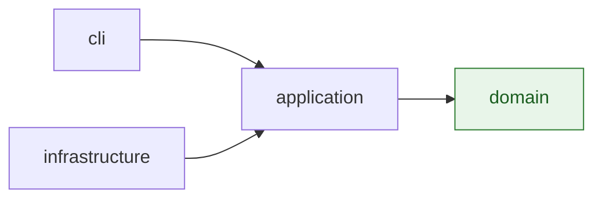

# Architecture

`glacier-backup` is a hexagonal (ports and adapters) design split across four
Gradle modules with one-way dependencies:



`infrastructure` implements the port interfaces that `application` defines,
so at compile time `application` and `domain` never see AWS SDK or
filesystem types — only `cli` wires the concrete adapters in.

## Modules

### `domain`

Pure Java: no Micronaut, no AWS SDK, no I/O. Value objects (`RelativePath`,
`LocalFile`, `RemoteObject`, `LocalSnapshot`, `RemoteSnapshot`,
`StorageClass`, `RestoreState`), policies (`SyncPolicy`, `PathFilter`), and
the sync-planning algorithm (`SyncPlanner`). Everything here is a pure
function or an immutable value; it has no dependencies on any other module.
See [`docs/domain-model.md`](domain-model.md) for the full catalogue.

### `application`

One use case per CLI command — `SyncUseCase`, `UploadUseCase`,
`DeleteUseCase`, `ListUseCase`, `RestoreUseCase`, `RestoreStatusUseCase`,
`DownloadUseCase` — each orchestrating the port interfaces
(`LocalVolume`, `RemoteStorage`, `ProgressReporter`) and domain services.
`application` depends only on `domain`; it defines the ports but never
implements them. Each use case returns a result record with per-item
outcomes (`FailedItem` lists), so a single bad file never aborts a whole
`sync` or `up` run — the CLI layer turns "some failures" into exit code `1`.

### `infrastructure`

Adapters that implement the `application` ports:

- `S3RemoteStorage` (`infrastructure/s3`) — AWS SDK v2, backed by
  `S3TransferManager` for uploads (multipart-capable) and `S3Client` for
  everything else (list, delete, restore, head, get). `RestoreHeaderParser`
  turns the `x-amz-restore` response header into a `RestoreState`.
  `S3RemoteStorageFactory` builds the client pair, with an overload that
  accepts an endpoint override for LocalStack-backed tests.
- `NioLocalVolume` (`infrastructure/fs`) — walks a local directory tree with
  a bounded pool of scan workers (one directory per task; see
  `--scan-threads`), applying a `PathFilter` and producing a `LocalSnapshot`.
  It does not follow symlinks, backs up files with undecodable names under a
  sanitized name, and reports directories that vanished mid-scan so that
  `sync --delete` can refuse to plan deletes from an incomplete picture.

The S3 client is tuned for slow, saturated home uplinks (16 MiB multipart
parts, at most four in flight, long write timeouts). `RetryingRemoteStorage`
(in `application`) decorates any `RemoteStorage` and retries `put` up to three
times with 10 s and 60 s backoffs; every other operation passes straight
through, since the AWS SDK already retries those.

`infrastructure` depends on `application` (to implement its ports) and
`domain` (transitively, for the types those ports speak in). It never
depends on `cli`.

### `cli`

Micronaut + Picocli commands, configuration loading, progress rendering,
and exit codes. `GlacierBackupCommand` is the Picocli root; each subcommand
(`SyncCommand`, `UpCommand`, `RmCommand`, `LsCommand`, `RestoreCommand`,
`RestoreStatusCommand`, `GetCommand`) extends `AbstractCommand`, which
resolves an `AppContext` from the `--config` path and translates a thrown
`ConfigException` into exit code `2`. `S3AppContext` is the production
`AppContext`: it loads `ToolConfig` via `ConfigLoader` (search order in
[Configuration](configuration.md#where-the-config-file-is-found)) and wires the real
`S3RemoteStorage` and `NioLocalVolume` adapters into each use case.
`cli` is the only module that depends on `infrastructure`, Micronaut, and
Picocli, and the only one compiled to a GraalVM native image.

## Traced example: `glacier-backup sync media`

```mermaid
sequenceDiagram
    participant User
    participant Picocli as GlacierBackupCommand / SyncCommand
    participant Config as ConfigLoader
    participant UseCase as SyncUseCase
    participant Planner as SyncPlanner (domain)
    participant S3 as S3RemoteStorage

    User->>Picocli: glacier-backup sync media
    Picocli->>Config: load(--config or default search path)
    Config-->>Picocli: ToolConfig (bucket, region, backupSets)
    Picocli->>Picocli: resolve backupSets["media"] -> local, prefix, filters
    Picocli->>UseCase: run(localRoot, remotePrefix, SyncPolicy, dryRun)
    UseCase->>UseCase: localVolume.scan(localRoot, filter) -> LocalSnapshot
    UseCase->>S3: list(remotePrefix) -> RemoteSnapshot
    UseCase->>Planner: plan(local, remote, policy)
    Planner-->>UseCase: SyncPlan (Upload / DeleteRemote / Skip actions)
    alt dry run
        UseCase-->>Picocli: SyncResult(plan, dryRun=true)
        Picocli-->>User: print plan, reasons, summary counts
    else execute
        loop each planned Upload
            UseCase->>S3: put(sourceFile, key, storageClass)
        end
        loop each planned DeleteRemote (only if --delete)
            UseCase->>S3: delete(key)
        end
        UseCase-->>Picocli: SyncResult(uploadedKeys, deletedKeys, failures)
        Picocli-->>User: print failures (if any); exit 0 or 1
    end
```

`sync media` resolves `media` against `backupSets` in the loaded config —
giving both a set name and a remote prefix on the command line is a usage
error (exit `2`). The diffing that drives `Upload` / `DeleteRemote` / `Skip`
decisions lives entirely in `SyncPlanner`, a pure domain function; neither
`cli` nor `application` re-implements diff logic.
