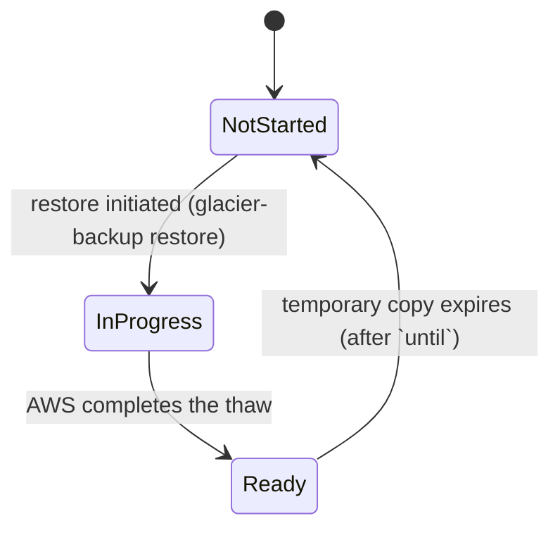

# Domain model

Everything in this document lives in the `domain` module: pure Java, no I/O,
no AWS SDK. Public methods never return `null` — absence is `Optional`,
empty collections, or a thrown exception.

## Value objects

### `RelativePath`

`record RelativePath(String value)`, the shared identity between the local
and remote worlds — it maps 1:1 to the S3 key suffix under a remote prefix
(see `RemoteKeys` in `application`). Constructed via `RelativePath.of(raw)`:

- Backslashes are normalized to `/`.
- A leading `./` is stripped.
- **Invariant:** the raw value must not be blank, must not start with `/`
  (absolute paths are rejected), and no path segment may be `..` (parent
  traversal is rejected). Violations throw `InvalidRelativePathException`.

### `LocalFile`

`record LocalFile(RelativePath path, long sizeBytes, Instant modifiedAt)` —
a file discovered under a local scan root.

### `RemoteObject`

`record RemoteObject(RelativePath path, long sizeBytes, Instant lastModifiedAt, StorageClass storageClass, RestoreState restoreState)`.

`downloadable()` is `true` when the storage class doesn't require a restore
(`STANDARD`, `GLACIER_IR`), or when it does and `restoreState` is
`RestoreState.Ready`.

### `LocalSnapshot` / `RemoteSnapshot`

Immutable, keyed by `RelativePath` (backed by a `TreeMap`, so iteration is
path-sorted). Built via `LocalSnapshot.of(Collection<LocalFile>)` /
`RemoteSnapshot.of(Collection<RemoteObject>)`.

- **Invariant:** no two entries may share a `RelativePath` — a duplicate
  throws `IllegalArgumentException` at construction.
- `find(RelativePath)` returns `Optional`; `all()` returns an immutable,
  path-sorted `List`; `size()` returns the count.

### `StorageClass`

```
STANDARD | GLACIER_IR | GLACIER | DEEP_ARCHIVE
```

`requiresRestore()` is `true` for `GLACIER` and `DEEP_ARCHIVE` only —
those are the two classes where an object's bytes are not directly
retrievable and must be thawed first. `DEEP_ARCHIVE` is the tool's default
(see [Storage classes and costs](configuration.md#storage-classes-and-costs)).

### `RestoreState`

A sealed interface with three variants, derived from the S3
`x-amz-restore` response header (parsed by
`infrastructure/s3/RestoreHeaderParser`):

```
NotStarted | InProgress | Ready(until: Instant)
```

See [Restore state machine](#restore-state-machine) below for transitions.

## Policies and plans

### `PathFilter`

Wraps two lists of `java.nio.file` glob matchers — `includeMatchers` and
`excludeMatchers` — built from glob strings via `PathFilter.of(includeGlobs,
excludeGlobs)`. `PathFilter.acceptAll()` is the identity filter (no
excludes, empty includes).

`matches(RelativePath path)`:

1. If any exclude glob matches, the path is rejected — **exclude always
   wins over include**.
2. Otherwise, the path is accepted if the include list is empty (empty
   include list means "include everything"), or if any include glob
   matches.

**Glob depth subtlety:** these are `java.nio.file` globs, not shell globs.
`**/*.tmp` matches `a/b/file.tmp` but does **not** match a top-level
`file.tmp` (`**` requires at least one directory segment before matching).
To exclude a pattern at every depth including the top level, list both
`*.tmp` and `**/*.tmp`.

### `SyncPolicy`

`record SyncPolicy(boolean deleteRemote, StorageClass storageClass, PathFilter filter)`.
`SyncPolicy.defaults()` is `(deleteRemote=false, storageClass=DEEP_ARCHIVE,
filter=acceptAll())`.

### `SyncPlanner` and the diff rules

`SyncPlanner.plan(LocalSnapshot local, RemoteSnapshot remote, SyncPolicy
policy, int vanishedDirectoryCount)` is a pure function:
`(LocalSnapshot, RemoteSnapshot, SyncPolicy, int) → SyncPlan`. For every local file that passes `policy.filter()`:

| Condition | Action | Reason constant |
|---|---|---|
| No remote object at that path | `Upload` | `SyncPlanner.REASON_NEW` — "new file, not present remotely" |
| Remote object exists, sizes differ | `Upload` | `SyncPlanner.REASON_SIZE_DIFFERS` — "local and remote sizes differ" |
| Remote object exists, same size, local `modifiedAt` is after remote `lastModifiedAt` | `Upload` | `SyncPlanner.REASON_LOCAL_NEWER` — "local file modified after remote" |
| Remote object exists, same size, local not newer | `Skip` | `SyncPlanner.REASON_UP_TO_DATE` — "local and remote are in sync" |

Independently, for every remote object that passes `policy.filter()` and has
no local counterpart:

| Condition | Action | Reason constant |
|---|---|---|
| `policy.deleteRemote()` is `true` | `DeleteRemote` | `SyncPlanner.REASON_REMOTE_ORPHAN` — "remote object has no local counterpart" |
| `policy.deleteRemote()` is `false` | *(no action — the object is left alone)* | — |

Local files that fail `policy.filter()` are skipped from the diff entirely
(no `Skip` action is recorded for them); deletion additive-by-default
matches `rsync` / `aws s3 sync` convention — a local accident must not
silently destroy the backup.

**Incomplete scans and deletes.** `vanishedDirectoryCount` is how many
directories the local scan had to skip because they vanished mid-walk. The
local snapshot may then be missing files for reasons other than a real local
deletion, so combining `deleteRemote` with a non-zero count makes the planner
throw `IncompleteScanForDeleteException`. `SyncUseCase` catches this case
earlier: it logs an error, drops the delete flag for that run (uploads still
proceed) and reports a failure, so the CLI exits `1`.

### `SyncPlan` / `SyncSummary`

`SyncPlan` is an ordered `List<PlannedAction>` (`Upload | DeleteRemote |
Skip`, a sealed interface). `uploads()` / `deletes()` / `skips()` filter the
list by variant. `summary()` reduces it to a `SyncSummary(uploadCount,
deleteCount, skipCount, bytesToUpload)` for the CLI's dry-run and post-sync
output.

### `RestoreRequest` and tier legality

`RestoreRequest.of(RelativePath path, StorageClass storageClass, RestoreTier
tier, int days)` makes illegal restores unrepresentable — it validates and
throws before any network call:

- `storageClass.requiresRestore()` must be `true` — otherwise
  `RestoreNotApplicableException` (restoring `STANDARD` or `GLACIER_IR`
  makes no sense; those are already retrievable).
- `tier == EXPEDITED` is rejected for `storageClass == DEEP_ARCHIVE` with
  `UnsupportedRestoreTierException` — Deep Archive has no expedited tier.
- `days` must be `>= 1`, otherwise `IllegalArgumentException`.

#### Tier x storage class legality matrix

| | `STANDARD` | `GLACIER_IR` | `GLACIER` | `DEEP_ARCHIVE` |
|---|---|---|---|---|
| Restore applicable at all | ✗ (`RestoreNotApplicableException`) | ✗ (`RestoreNotApplicableException`) | ✓ | ✓ |
| `BULK` | — | — | ✓ | ✓ |
| `STANDARD` | — | — | ✓ | ✓ |
| `EXPEDITED` | — | — | ✓ | ✗ (`UnsupportedRestoreTierException`) |

## Restore state machine



- **`NotStarted`** — the default for any object whose storage class requires
  restore and that has never had a restore requested (or whose prior
  restored copy has expired). No `x-amz-restore` header, or a header the
  parser doesn't recognize.
- **`InProgress`** — set the moment `RemoteStorage.initiateRestore(key, tier,
  days)` succeeds; the S3 header carries `ongoing-request="true"` until AWS
  finishes the thaw. Duration depends on tier and storage class (minutes for
  expedited Glacier, up to 48 hours for Deep Archive bulk — see
  [Usage: Restoring data](usage.md#restoring-data)).
- **`Ready(until)`** — the header carries `ongoing-request="false"` plus an
  `expiry-date`; the object's bytes are retrievable via `get` until
  `until`. `RemoteObject.downloadable()` is `true` only in this state (for
  storage classes that require restore). After `until`, S3 reclaims the
  temporary copy and status reverts to `NotStarted`.

`DownloadUseCase` enforces this at the application boundary: a `get` on a
key whose storage class requires restore and whose current `RestoreState` is
not `Ready` fails with a clear message ("not ready to download yet; run
restore-status to check progress") before any download attempt.
